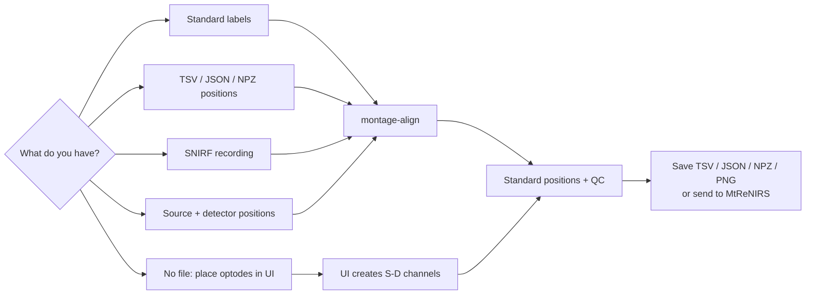
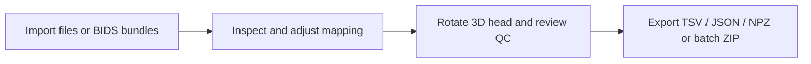
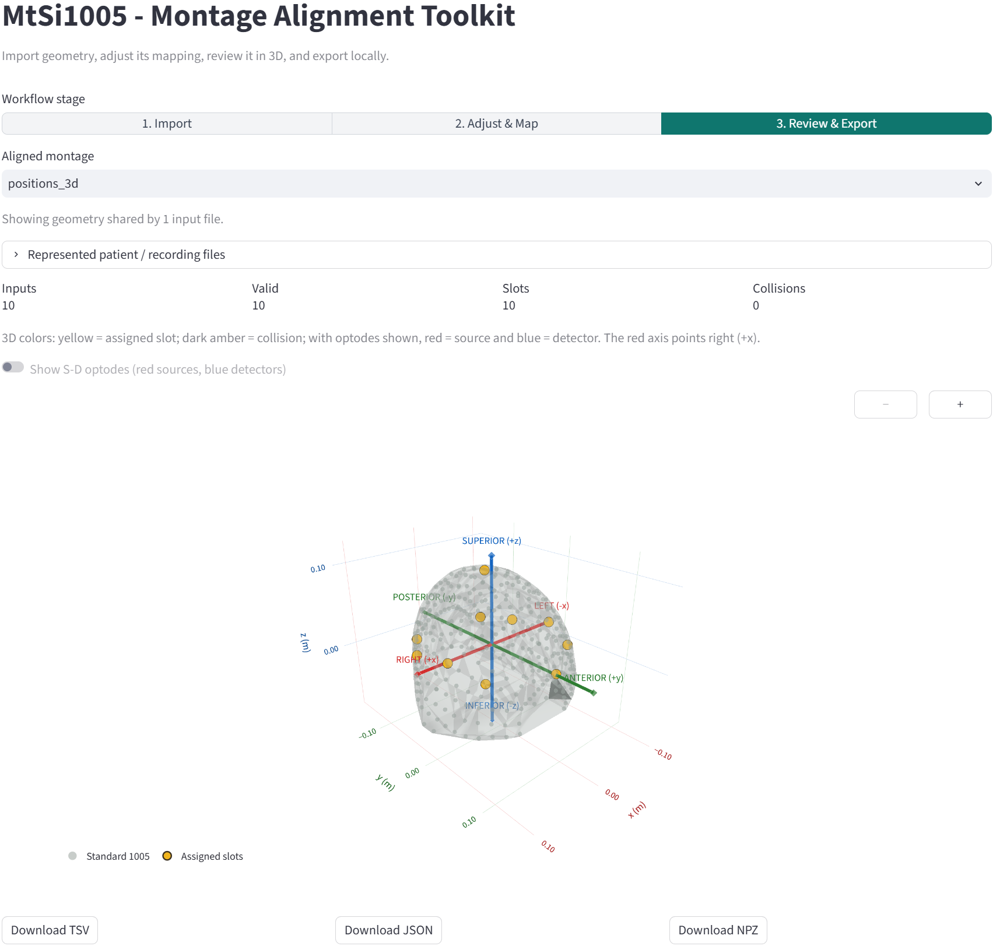

# MtSi1005

MtSi1005 maps EEG electrode or fNIRS channel geometry to a shared MNE
`standard_1005` coordinate space. It accepts geometry only, not brain signals.
For fNIRS, it can derive channel locations from source-detector midpoints.

MtSi1005 is independently installable as `mtrenirs-alignment`; it does not
depend on the MtReNIRS model package or PyTorch.

For fNIRS terminology, a **physical S-D pair** is one source-detector geometry.
An HbO row, HbR row, or wavelength row is a separate **measurement channel**.
Multiple measurement channels from the same S-D pair therefore share one
midpoint. MtSi1005 preserves those rows and their order when they are supplied;
MtReNIRS expects each chromophore row as a separate model input channel.

## Choose a workflow

The package accepts **geometry only**. It does not read, preprocess, upload, or
store fNIRS/EEG time-series signals. The aligned `ch_pos_1005` output can be
passed directly to MtReNIRS.



### Interactive batch workflow

The UI is the easiest path when files use mixed geometry formats or several
montages must be processed together:



<p align="center">
    
</p>

<p align="center"><em>Review an aligned montage in 3D before exporting TSV, JSON, or NPZ.</em></p>

### Supported inputs

| Input | Required content | Entry point |
| --- | --- | --- |
| TSV | `name`, `x`, `y`; optional numeric `z` | `montage-align positions.tsv` |
| TXT | Delimited `name`/`channel`/`label`, `x`, `y`; optional `z` | UI |
| NPZ | `ch_names`, `ch_pos`; optional unit/frame metadata | `montage-align positions.npz` |
| JSON | Same keys as NPZ; nested lists instead of arrays | `montage-align positions.json` |
| SNIRF | Embedded MNE channel geometry | `montage-align recording.snirf` |
| BIDS NIRS folder | Inherited `optodes.tsv`, `coordsystem.json`, `channels.tsv` | UI folder/ZIP import |
| XDF | Per-channel xyz metadata, or a recognized Muse S Athena Optics stream | UI |
| MNE Raw | Any device with valid channel `loc[:3]` | `from_mne_raw(raw)` |
| Channel arrays | Names plus `(N,2)` or `(N,3)` positions | `align(...)` |
| Canonical labels | One Standard 1005/1020 label per row | `align(..., canonical_labels=...)` |
| Optode arrays | Source xyz, detector xyz, and index pairs | `align_optodes(...)` |
| Manual placement | Click Standard 1005 source/detector slots | `montage-align-ui` |

### Bundled synthetic examples

`example_test_input/` contains eight package-authored scenarios with 8–10 rows
or physical S-D pairs each. They are safe demonstrations of the supported
schemas, not modified excerpts from the pretraining datasets.

| Scenario | Format | Use it to check |
| --- | --- | --- |
| `01-canonical-labels` | JSON | Direct Standard 1005 labels with coordinate placeholders |
| `02-positions-3d` | TSV | Isotropic 3D alignment from named xyz rows |
| `03-positions-2d` | TXT | Planar projection alignment from named xy rows |
| `04-standard-frame` | NPZ | Coordinates already declared in `standard_1005` |
| `05-missing-position` | JSON | Validity handling for one missing coordinate row |
| `06-bids-fnirs` | BIDS TSV/JSON set | Optode coordinates, wavelength deduplication, and S-D midpoints |
| `07-minimal-snirf` | SNIRF | Embedded binary optode geometry in a valid minimal recording |
| `08-canonical-collision` | JSON | Collision reporting when labels share a target slot |

For the easiest comparison, launch `montage-align-ui`, choose **Example test
input**, load the scenarios, then use **Align all automatically**. Standalone
coordinate and SNIRF examples can also be run from the repository root:

```bash
montage-align example_test_input/02-positions-3d/positions_3d.tsv \
    --output-dir outputs/positions-3d
montage-align example_test_input/04-standard-frame/standard_frame.npz \
    --output-dir outputs/standard-frame
montage-align example_test_input/07-minimal-snirf/synthetic_recording.snirf \
    --mode snirf --output-dir outputs/minimal-snirf
```

Canonical-label and BIDS bundle examples are best opened in the UI because the
UI reads `canonical_labels` and resolves the three BIDS sidecars together. See
[`example_test_input/README.md`](example_test_input/README.md) for exact row
counts, expected methods, expected output manifests, units, and regeneration.
The BIDS and SNIRF files each contain 8 physical S-D pairs represented at two
wavelengths. The UI deduplicates them to 8 geometry rows; the single-file SNIRF
CLI preserves all 16 wavelength measurement rows.

### One montage per command

The CLI accepts exactly one input file per run. One file represents one montage,
with one row per channel or electrode. Names and coordinates must have the same
length and order. Process multiple montages with separate output directories:

```bash
montage-align montage_a.tsv --unit mm --output-dir outputs/montage_a
montage-align montage_b.npz --output-dir outputs/montage_b
montage-align recording.snirf --mode snirf --output-dir outputs/recording
```

The file formats contain channel/electrode positions, not time-series signals.
Source-detector arrays and `canonical_labels` are Python API inputs; manual
source/detector placement is available through the UI.

### Exact input formats

**TSV:** tab-separated `name`, `x`, and `y` columns; `z` is optional. Set its
unit with the CLI `--unit` option.

```tsv
name	x	y	z
ch01	-31.2	82.4	48.1
ch02	 30.8	81.9	49.0
```

**JSON:** `ch_names` and `ch_pos` are required. Position rows contain either two
or three numbers. Unit and frame metadata are optional and default to `m` and
`head`.

```json
{
    "ch_names": ["ch01", "ch02"],
    "ch_pos": [[-31.2, 82.4, 48.1], [30.8, 81.9, 49.0]],
    "meta_ch_pos_unit": "mm",
    "meta_ch_pos_frame": "head"
}
```

**NPZ:** the same keys stored as NumPy arrays.

```python
import numpy as np

np.savez_compressed(
        "positions.npz",
        ch_names=np.asarray(["ch01", "ch02"]),
        ch_pos=np.asarray([[-31.2, 82.4, 48.1], [30.8, 81.9, 49.0]]),
        meta_ch_pos_unit=np.asarray("mm"),
        meta_ch_pos_frame=np.asarray("head"),
)
```

Saved `mapping.json` and `mapping.npz` use `ch_pos_1005` instead of `ch_pos`;
both keys are accepted when those mappings are used as inputs again.

### File and device modes

```text
--mode auto       Detect .snirf; otherwise use the position-file loader
--mode positions  Read .tsv, .json, or .npz channel positions
--mode snirf      Read channel geometry embedded in a SNIRF file through MNE
```

SNIRF mode uses the same MNE `raw.info["chs"][i]["loc"][:3]` channel-position
convention as the original preprocessing pipeline. Wavelength/HbO/HbR
measurement channels remain separate rows, so repeated pair positions are
preserved. Collision QC treats those repeated rows as one physical S-D pair.
If a SNIRF file lacks usable geometry, provide a TSV/JSON/NPZ
sidecar or use the placement UI.

Other devices can use the same geometry adapter after loading or converting
their data to MNE Raw:

```python
from mtrenirs.alignment import align, from_mne_raw

montage = from_mne_raw(raw)
result = align(montage)
```

XDF does not define a common sensor-geometry schema. The UI imports generic XDF
when one stream contains per-channel labels and `location/x,y,z` metadata. It
also recognizes the fixed 16-channel `Muse-OPTICS` stream from Muse S Athena
and derives its four physical source-detector midpoints from the device layout
in the MNE Standard 1005 head frame. For other streams without coordinates,
upload a position TSV/JSON sidecar, convert the data to MNE Raw with valid
channel locations, use known canonical labels, or place optodes manually.
Dataset-specific schematic grids, axis corrections, and fixed label maps remain
in dataset adapters rather than being silently guessed here.

### User-set parameters

| Parameter | Values/default | Purpose |
| --- | --- | --- |
| `unit` | `"m"` (default), `"cm"`, `"mm"` | Input coordinate unit |
| `frame` | `"head"` by default | Input coordinate frame |
| `reference` | `"standard_1005"` or `"standard_1020"` | Target montage |
| `modality` | `"fnirs"` by default | Input metadata |
| `canonical_labels` | Optional sequence | Bypass geometric estimation for known slots |
| `channel_pairs` | `(source_index, detector_index)` pairs | Build fNIRS channel midpoints |
| `--output-dir` | `montage-alignment-output` | CLI export directory |
| UI distance range | Inclusive `[8,35]` mm by default | Accept automatic S-D pairs |

The CLI exposes `--unit` and `--output-dir`; the full parameter set is available
through the Python API. The placement UI uses Standard 1005 and evaluates all
source x detector combinations automatically.

### Alignment contract

- Known canonical labels map directly to their reference coordinates.
- Standard-frame 3D input uses nearest-slot assignment directly.
- Other 3D input is centered and isotropically scaled before nearest assignment.
- 2D input is aligned in azimuthal projection space.
- Assignment is independent per physical channel, so distinct channels assigned
    to one slot are reported rather than silently forced into a one-to-one mapping.
- HbO/HbR or wavelength rows from the same fNIRS S-D pair do not count as a
    collision.
- Missing/non-finite rows remain invalid. At least two distinct finite positions
    are required when geometric alignment must estimate scale.

### Files and folders

No dataset folder hierarchy or filename convention is required. The CLI accepts
one TSV or NPZ path and creates the requested output directory:

```text
my-project/
├── geometry/
│   └── positions.tsv       # or positions.npz
└── alignment-output/
    ├── mapping.tsv
    ├── mapping.json
    ├── mapping.npz
    └── montage_before_after.png
```

The UI accepts a single geometry file, several independent files, a browser
folder selection, or a ZIP archive. Folder and ZIP modes
search recursively, so BIDS files do not need to be copied into one directory.
For each `channels.tsv`, compatible
`optodes.tsv` and `coordsystem.json` files are resolved through BIDS filename
entities and inheritance. The UI also works without an input file through
manual source/detector placement.

Folder scanning is schema-based rather than extension-based. Position tables,
geometry JSON/NPZ, geometry-bearing SNIRF/XDF, BIDS NIRS sidecar sets, and
numbered probe coordinate files are retained. Events, participants, scans,
anatomy text, metadata JSON, derivative/QC tables, unrelated modality files,
repeated wavelength rows, repeated runs with identical geometry, and other
non-montage files are automatically excluded. Unsupported vendor MAT/NIRS files
produce one grouped adapter alert when no recognized geometry is available.

## Installation

Python 3.10 or newer is required.

> `mtrenirs-alignment` is not yet published to PyPI. Until the first public release,
> clone its repository and install the source package:

```bash
git clone <mtrenirs-repository-url>
cd MtReNIRS/alignment
pip install -e .
```

If this workspace is already checked out, install it directly from the parent
directory:

```bash
pip install -e ./MtReNIRS/alignment
```

After the PyPI release, installation will be:

```bash
pip install mtrenirs-alignment
```

The same dependencies are listed in `requirements.txt` for environments that
install from requirements files.

## Repository structure

```text
alignment/
├── pyproject.toml                 # Build metadata, dependencies, and CLI entry points
├── requirements.txt              # Package dependencies
├── README.md
├── example_test_input/            # Public synthetic files and expected results
│   └── README.md                  # Scenario details and usage notes
├── scripts/
│   └── generate_example_test_inputs.py
├── examples_opensource_fnirs/
│   ├── pretraining_montage_examples.ipynb
│   └── final-results/             # Rendered pretraining QC gallery
├── src/mtrenirs/alignment/
│   ├── alignment.py              # Standard 1005 assignment
│   ├── models.py                 # Input and result data models
│   ├── io.py                     # TSV and NPZ readers
│   ├── plotting.py               # Static QC rendering
│   ├── ui.py                     # Local Streamlit placement UI
│   ├── cli.py                    # `montage-align` command
│   └── __init__.py
└── tests/
    └── test_alignment.py
```

## Command line

Align a TSV, JSON, or NPZ coordinate file and write TSV, JSON, and NPZ mappings
plus a before/after QC image:

```bash
montage-align positions.tsv --unit mm --output-dir output
```

The TSV must contain `name`, `x`, and `y` columns. A numeric `z` column enables
3D alignment; otherwise the package uses a 2D azimuthal projection. Supported
units are `m`, `cm`, and `mm`.

An NPZ input must contain:

| Key | Shape | Description |
| --- | --- | --- |
| `ch_names` | `(channels,)` | Channel or electrode names |
| `ch_pos` | `(channels, 2 or 3)` | Input positions |
| `meta_ch_pos_unit` | scalar, optional | `m`, `cm`, or `mm`; defaults to `m` |
| `meta_ch_pos_frame` | scalar, optional | Coordinate frame; defaults to `head` |

JSON uses the same keys, with arrays represented as JSON lists. Saved
`mapping.json` and `mapping.npz` files can be used as inputs again.

## Python API

```python
from mtrenirs.alignment import MtSi1005

result = MtSi1005.align(positions=xyz, names=channel_names, unit="mm")
result.save_npz("mapping.npz")
result.save_tsv("mapping.tsv")
result.plot("alignment.png")
```

The result includes the assigned Standard 1005 slot IDs and labels, canonical
3D coordinates in metres, validity flags, nearest-slot distances, the distance
unit, and any assignment collisions. Inspect `result.collisions` before treating
a mapping as final; repeated chromophore/wavelength rows from one S-D pair are
treated as one physical channel.

If input rows already have Standard 1005 labels, bypass geometric estimation:

```python
result = align(
    positions=xyz,
    names=channel_names,
    canonical_labels=standard_1005_labels,
)
```

For fNIRS source and detector geometry:

```python
from mtrenirs.alignment import MtSi1005

result = MtSi1005.align_optodes(
    source_positions=source_xyz,
    detector_positions=detector_xyz,
    channel_pairs=[(0, 0), (0, 1), (1, 1)],
    unit="m",
)
```

Each pair is converted to a source-detector midpoint, projected back to the
median optode radius for 3D inputs, and assigned to its nearest reference slot.

## Using the result with MtReNIRS

`AlignmentResult` exposes the two arrays expected by MtReNIRS directly. Keep the
signal, channel types, names, and geometry in the same channel order:

```python
from mtrenirs.alignment import MtSi1005
from mtrenirs.models import MtReNIRS

mapping = MtSi1005.align(
    positions=channel_xyz,
    names=channel_names,
    unit="mm",
    modality="fnirs",
)
model = MtReNIRS.from_pretrained(
    ch_types=ch_types,
    ch_pos_1005=mapping.ch_pos_1005,
    ch_pos_1005_valid=mapping.valid,
)
embeddings = model.embed(fnirs, pool="flatten")
```

For SNIRF or MNE Raw input, `mtrenirs.models.preprocessing.load_snirf(...,
align_positions=True)` and `from_mne_raw(..., align_positions=True)` invoke this
alignment automatically.

## Local alignment UI

```bash
mtsi1005-ui
```

`montage-align-ui` is a retained alias and launches the same application.
The Streamlit UI runs locally and keeps uploaded data in the local process.

1. **Import:** upload one or more TSV/TXT/JSON/NPZ/SNIRF/XDF files. A TSV by
    itself is enough for one montage. For nested BIDS data, choose the root with
    **Upload folder** or upload it as ZIP. The UI
    recursively resolves inherited `optodes.tsv`, `coordsystem.json`, and
    `channels.tsv`; users do not need to reorganize those files. Each independent
    file or BIDS `channels.tsv` becomes one montage.
2. **Adjust & Map:** align every montage automatically, then select one montage
    to edit coordinates, units, frame, axis order/sign, or canonical labels.
    Manual placement on all 343 Standard 1005 slots remains available.
3. **3D Review & Export:** rotate and zoom the Standard 1005 scalp view, inspect
    validity/collisions, download one mapping, or export all results as a ZIP
    containing any selected combination of TSV, JSON, and NPZ.

For manual fNIRS placement, all source x detector combinations are evaluated
using physical 3D Standard 1005 distances. The default accepted interval is
inclusive `[8, 35] mm`; accepted midpoints become channel rows.

## Alignment behavior

- Canonical labels map directly to their reference coordinates.
- 3D coordinates already marked as `standard_1005` use nearest-neighbor
	assignment without a second alignment transform.
- Other 3D coordinates are centroid-aligned and isotropically RMS-scaled before
	nearest-neighbor assignment.
- 2D coordinates use the same alignment and assignment in azimuthal projection
	space; their reported distance unit is `projection`, not metres.
- Missing or non-finite positions remain invalid and receive slot ID `-1`.

## Privacy and redistribution boundary

This repository must not contain original or transformed per-dataset montage
tables, optode coordinates, geometry snapshots, or per-dataset mappings from
third-party pretraining datasets. Public examples must use synthetic or
explicitly redistributable geometry.

`examples_opensource_fnirs/final-results/` contains the two overview figures and 12 approved
rendered pretraining-montage examples. These images are not machine-readable
coordinate sources. No original montage CSV, TSV, NPZ, or source geometry is
distributed.

`example_test_input/` contains package-authored synthetic scenarios for the
TSV, TXT, JSON, NPZ, BIDS fNIRS, and SNIRF adapters. The examples contain no
patient data or coordinates derived from a pretraining dataset. They are
included in source distributions and wheels; see that directory's README for
the expected alignment behavior of each scenario.

`examples_opensource_fnirs/pretraining_montage_examples.ipynb` runs all four public alignment
methods (`isotropic_3d_nearest`, `canonical_3d_nearest`,
`isotropic_2d_nearest`, and `canonical_labels`) on package-authored synthetic
inputs. It also demonstrates S-D midpoint construction with `align_optodes`,
shows the aggregate 12-dataset overview, and renders all 12 final QC images.

## Original pretraining dataset sources

The pretraining datasets referenced in the QC gallery originate from the
following external sources. This repository does not redistribute their raw
data; access, licensing, and citation requirements are determined by each
dataset provider.

| Dataset | Original data source |
| --- | --- |
| Ajra2026 cognitive-motor | TODO: add source URL |
| Chen2023 Stroop | TODO: add source URL |
| Defenderfer2019 speech perception | TODO: add source URL |
| Ferron2019 anesthesia | TODO: add source URL |
| Gao2023 ball squeezing | TODO: add source URL |
| Hudak2017 ADHD | TODO: add source URL |
| Li2020 mirror motor | TODO: add source URL |
| Morgan2026 audio-visual | TODO: add source URL |
| Shin2017 cognitive | TODO: add source URL |
| Spape2023 emotion | TODO: add source URL |
| Sudan2026 cocktail visual | TODO: add source URL |
| Xiafei2024 driving | TODO: add source URL |
